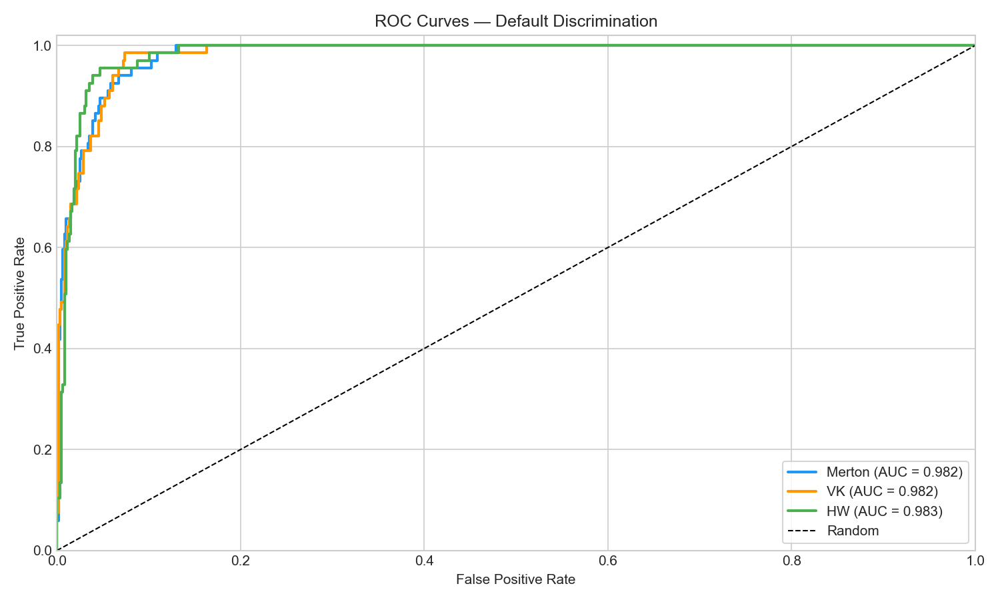
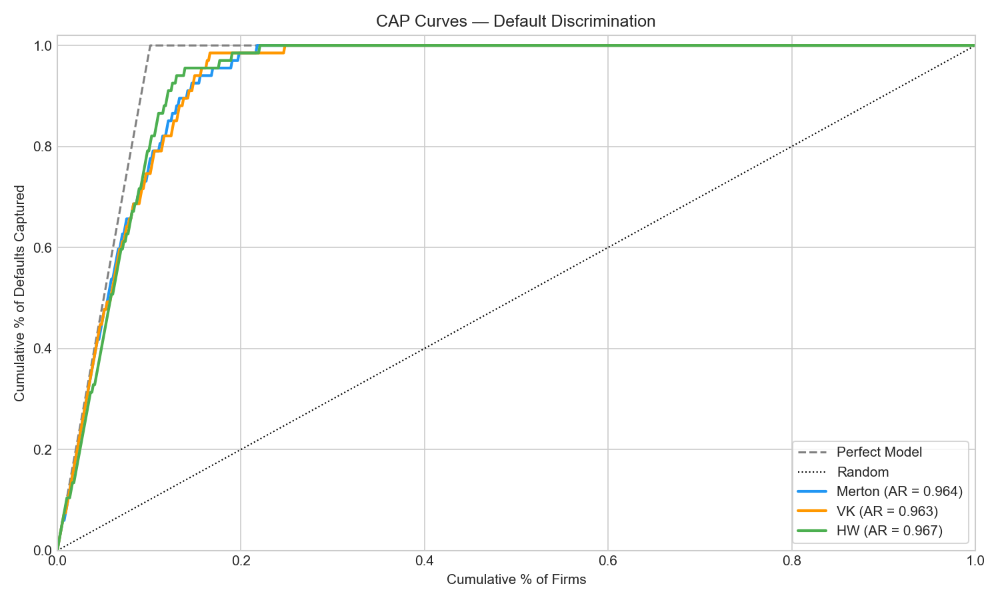
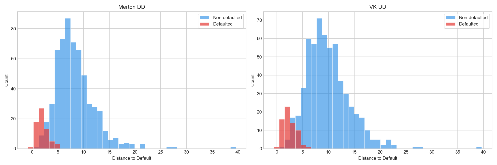
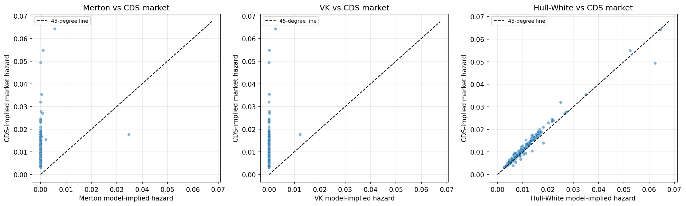

# Comparing Structural and Reduced-Form Credit Risk Models

Do structural credit models (Merton, VK/KMV) or a reduced-form intensity model (Hull–White) better measure default risk for U.S. listed firms — and does strong default *discrimination* translate into correct default *levels* when benchmarked against the CDS market?

**Weiyu Wang · Yixuan Wang · Han Zheng · Jun Zhang · Tingrui Zhang · Zhankai Zhang** — Boston University MF728 Fixed Income Securities, Spring 2026

📄 **[Full report (PDF)](docs/Grp03_mf728_report.pdf)**

---

## Key findings

- **Both structural models discriminate defaults almost equally well.** On the 163-firm labelled panel, Merton reaches ROC-AUC 0.9818 / CAP-AR 0.9637 and VK/KMV 0.9815 / 0.9631. The gap is far smaller than the methodological distance between the two specifications — the extra VK machinery (default point, iterative asset solve, physical drift) buys essentially no discriminatory power here.

- **Rank-ordering works; absolute levels do not.** Against the CDS-implied market hazard, Merton and VK achieve respectable cross-sectional rank correlation (Spearman ρ = 0.567 and 0.556) but strongly negative level fit (R² = −2.04 and −2.07). Structural PDs order investment-grade credits correctly while mispricing their level by a wide margin.

- **The level gap is structural, not a recovery-rate artefact.** Repeating the comparison on expected loss, which cancels the recovery assumption, leaves R² at −1.95 (Merton) and −1.96 (VK). The shortfall is a property of the GBM / single-barrier framework at investment-grade default probabilities, not of the assumed R.

- **Walk-forward rescaling narrows the gap but never closes it.** An out-of-sample linear calibration λ̂ = a + b·λ_model lifts Merton's R² from −3.06/−4.02/−3.99 (raw) to −0.52/−0.37/−0.26 across the 2023/2024/2025 hold-out years — a large improvement that still fails to beat a constant predictor.

Hull-White reproduces the market hazard almost exactly (ρ = 0.979, R² = +0.95), but this is **true by construction**: λ_HW is bootstrapped from the same par spread used to derive λ_market, so its fit is a sanity check on the PV solver rather than a model-evaluation result.

---

## Results

### Structural discrimination — 163 firms, 661 firm-years

| Model | AUC | AR |
|---|---:|---:|
| Merton (1974) | 0.9818 | 0.9637 |
| VK / KMV | 0.9815 | 0.9631 |

<p align="center">
  
  <br><em>ROC curves — Merton vs VK on the labelled panel.</em>
</p>

<p align="center">
  
  <br><em>Cumulative accuracy profiles, with the accuracy ratio as the area between model and random curves.</em>
</p>

<p align="center">
  
  <br><em>Distance-to-default separates distressed from non-distressed firm-years.</em>
</p>

Hull-White is excluded from this evaluation: the 21 distressed firms have no liquid 5Y CDS quotes, so AUC/AR cannot be computed for it on the labelled panel.

### CDS market calibration — 83 firms, 314 matched firm-years

Task A — pooled level matching against the CDS-implied market hazard λ_market = −ln(1−dp)/5:

| Model | n | Spearman ρ | Raw R² | RMSE |
|---|---:|---:|---:|---:|
| Merton | 314 | 0.567 | −2.04 | 0.0117 |
| VK / KMV | 314 | 0.556 | −2.07 | 0.0118 |
| Hull-White | 314 | 0.979 | +0.95 | 0.0015 |

Task A-2 — walk-forward linear calibration, R² on the hold-out year:

| Model | → 2023 | → 2024 | → 2025 |
|---|---:|---:|---:|
| Merton (raw → calibrated) | −3.06 → −0.52 | −4.02 → −0.37 | −3.99 → −0.26 |
| VK / KMV (raw → calibrated) | −3.06 → −0.52 | −4.08 → −0.38 | −3.99 → −0.26 |

Task B — cross-sectional Spearman ρ vs the CDS hazard, by year:

| Year | n | Merton | VK | Hull-White |
|---|---:|---:|---:|---:|
| 2022 | 73 | 0.691 | 0.658 | 0.991 |
| 2023 | 78 | 0.457 | 0.399 | 0.971 |
| 2024 | 79 | 0.525 | 0.532 | 0.972 |
| 2025 | 79 | 0.560 | 0.590 | 0.983 |

2021 is reported in the output files but covers only 5 firms, too few for a meaningful structural rank correlation.

Task C benchmarks every risk measure against Markit implied agency ratings; see `output/cds_calibration/taskC_rating_benchmark.csv`.

<p align="center">
  
  <br><em>Model-implied vs CDS-implied hazard. Merton and VK sit well off the 45° line; Hull-White lies on it by construction.</em>
</p>

All figures and tables above are produced by `notebooks/main.ipynb`; the underlying files are in `output/` and `output/cds_calibration/`.

---

## Sample

- **163 firms** — 142 never labelled distressed, 21 distressed
- **661 firm-year observations**, annual snapshots, 2021–2025 (67 firm-years carry a distress label)
- **CDS extract**: 84 investment-grade firms with liquid 5Y Markit quotes (398 firm-years), of which **83 firms / 314 firm-years** merge onto the structural panel and enter the calibration tests

Distress labels follow a broad credit-distress definition (Shumway, 2001; Campbell, Hilscher & Szilagyi, 2008) in three tiers: formal Chapter 11 filing (HTZ), going-concern warnings (PLUG, FCEL), and severe financial distress (LCID, RIVN, BYND, AMC, … 18 firms). The full list is in `src/config.py`; tier definitions are in `notebooks/main.ipynb` §1.6.

---

## Limitations

These bound how far the headline results should be read, and we state them plainly:

1. **The distress labels are broad.** They capture equity-market and going-concern distress, not only Chapter 11 filings. Only one firm in the sample (HTZ) is a formal bankruptcy. Equity-based distress is partly observable from the same market data that drives the models, so the reported AUC/AR of ~0.98 is very likely inflated relative to what a strict legal-default label would produce.
2. **Only 21 distressed firms.** With 21 distressed firms (67 labelled firm-years), the discrimination metrics rest on a small positive class. Confidence intervals around AUC/AR are correspondingly wide, and the Merton-vs-VK difference is well inside sampling noise.
3. **Annual snapshots only.** One observation per firm-year at year-end means the models cannot react to intra-year deterioration, and a firm's distress year is dated coarsely. This also understates the lead time a real early-warning system would need.
4. **GBM and single-barrier assumptions.** Both structural models assume geometric Brownian motion for asset value, a single default barrier, and a one-year horizon with no jumps, no stochastic volatility, and no debt rollover. These are exactly the assumptions implicated in the level gap documented above.
5. **Hull-White matches CDS by construction.** Its hazard is bootstrapped from the same 5Y par spread used to build the λ_market benchmark. Its near-perfect fit validates the PV solver only and must not be read as evidence that reduced-form models forecast default better.

---

## Licensed data

Two inputs are licensed WRDS products. They are **not redistributed** in this repository and are excluded by `.gitignore`; see `data_raw/README.md`. The cached merged panel `output/panel_data.csv` is committed, so sections 1–5 of the notebook (Merton, VK, discrimination) run without them. Sections 4 and 6 (Hull-White, CDS calibration) require `cds_parspread.csv`.

**`data_raw/cds_parspread.csv`** — WRDS → Markit CDS, one row per ticker-year:

| Column | Description |
|---|---|
| `ticker` | Equity ticker, mapped to the Markit reference entity |
| `date` | Last trading day of December |
| `year` | 2021–2025 |
| `tenor` | Contract tenor, filtered to `5Y` |
| `tier` | Debt seniority, filtered to `SNRFOR` |
| `currency` | Filtered to `USD` |
| `parspread` | 5Y par spread, decimal (0.0037 = 37 bp) |
| `dp` | Markit cumulative default probability to the tenor |
| `avrating` | Markit average agency rating |
| `impliedrating` | Markit CDS-implied rating |

**`data_raw/implied_vol_optionmetrics.csv`** — WRDS → OptionMetrics Ivy DB US, one row per ticker-year (ATM ~1Y call):

| Column | Description |
|---|---|
| `ticker` | Equity ticker |
| `date` | Observation date (year-end) |
| `exdate` | Option expiration date |
| `days` | Calendar days to expiry (filtered 250–450) |
| `delta` | Option delta (filtered 0.40–0.60, closest to 0.50 retained) |
| `impl_volatility` | Implied volatility, used as σ_E |
| `strike_price_actual` | Strike, rescaled from the OptionMetrics ×1000 convention |
| `volume` | Contract volume |

### Regenerating them (requires a WRDS subscription)

```bash
# Markit CDS → data_raw/cds_parspread.csv
# Download the WRDS Markit CDS dumps, then edit ZIP_PATHS at the top of the script:
PYTHONPATH=src python src/scripts/filter_cds.py

# OptionMetrics → data_raw/iv_YYYY.csv, one year at a time
PYTHONPATH=src python src/scripts/filter_optionmetrics.py ~/Downloads/opprcd_2021.zip data_raw/iv_2021.csv
# ... repeat for 2022–2025, then merge into implied_vol_optionmetrics.csv:
PYTHONPATH=src python src/scripts/filter_optionmetrics.py --merge

# Rebuild the merged panel (also pulls yfinance + FRED)
PYTHONPATH=src python -c "from data import build_panel; build_panel()"
```

Each script's docstring states its full filtering chain (year-end dates, 5Y/SNRFOR/USD for CDS; ATM ~1Y calls with valid IV and nonzero liquidity for OptionMetrics).

> **Note on committed outputs.** `output/panel_data.csv`, `output/panel_full_results.csv`, and `output/cds_calibration/panel_cds_calibration.csv` carry vendor-derived values in their `equity_vol` / `*_sigma_E` and `parspread` / `dp` / `avrating` / `impliedrating` columns. Redistribution terms for these should be confirmed before the repository is made public.

---

## Models

### Merton (1974) — structural

Equity is a European call on firm assets. Solve simultaneously for the unobservable $(V, \sigma_V)$:

$$E = VN(d_1) - De^{-rT}N(d_2), \qquad \sigma_E E = VN(d_1)\sigma_V$$

then

$$DD = \frac{\ln(V/D) + (r - \sigma_V^2/2)T}{\sigma_V\sqrt{T}}, \qquad PD = N(-DD)$$

### VK / KMV (Crosbie & Bohn, 2003) — structural

Three changes relative to Merton: the barrier becomes the default point $DP = STD + 0.5 \times LTD$ rather than total debt; asset value is estimated iteratively instead of by simultaneous solve; and DD uses the physical drift $\mu = r + 0.02$.

### Hull-White (2000) — reduced-form, CDS-bootstrapped

The hazard $\lambda$ is backed out of the observed 5Y par spread $s$. The credit triangle gives the closed-form benchmark

$$\lambda \approx \frac{s}{1 - R}$$

and a flat $\lambda$ is solved numerically from the protection-leg / premium-leg PV identity by Brent's method, with quarterly payments, accrual on default, and risk-free discounting. Then $PD = 1 - e^{-\lambda T}$.

Recovery is firm-specific and seniority-weighted (Altman & Kishore, 1996):

$$R = (\mathrm{STD}/D) \times 0.55 + (\mathrm{LTD}/D) \times 0.35$$

reflecting that short-term debt is typically secured (~55%) and long-term debt typically unsecured (~35%). Firm-years without a balance-sheet decomposition fall back to the ISDA convention $R = 0.40$.

---

## Repository layout

```
src/                    — Python package (sys.path entry; notebook handles this)
  config.py             — Tickers, sample window, model parameters
  data/                 — Data acquisition (rebuilds panel_data.csv)
    equity.py           — Prices, market cap, equity volatility (σ_E)
    balance_sheet.py    — Debt structure from yfinance financials
    risk_free.py        — Treasury rates from FRED (fallback: yfinance ^TNX)
    implied_vol.py      — Loads OptionMetrics implied vol from data_raw/
    merge.py            — Builds the firm-year panel + distress labels
  models/
    merton.py           — Merton: scipy.fsolve for (V, σ_V) → DD → PD
    vk.py               — VK/KMV: iterative asset solve, DP = STD + 0.5×LTD
    hull_white.py       — Hull-White: λ bootstrapped from 5Y CDS spreads
  analysis/
    discrimination.py   — ROC/AUC and CAP/AR
    visualization.py    — ROC, CAP, DD distribution, PD scatter
  scripts/
    filter_cds.py       — Markit dump → data_raw/cds_parspread.csv
    filter_optionmetrics.py — OptionMetrics → data_raw/iv_YYYY.csv → merge
data_raw/               — Licensed WRDS inputs (gitignored; see its README)
notebooks/main.ipynb    — End-to-end analysis, run top to bottom
output/                 — Generated CSVs and figures
  cds_calibration/      — Task A / B / C calibration outputs
docs/                   — Final report PDF and project proposal
```

---

## Reproducing the analysis

```bash
pip install -e .          # or: pip install -r requirements.txt
jupyter notebook notebooks/main.ipynb
```

Run the notebook top to bottom. It loads the cached `output/panel_data.csv` and `data_raw/cds_parspread.csv`, fits all three models, and rewrites every CSV and PNG in `output/`. No live API calls are made on a re-run, and the committed notebook already contains its executed outputs.

`FRED_API_KEY` is needed only when rebuilding the risk-free series from scratch; `src/data/risk_free.py` falls back to yfinance `^TNX` if it is unset.

```bash
export FRED_API_KEY="your_key_here"   # https://fred.stlouisfed.org/docs/api/api_key.html
```

---

## Data sources

| Source | Access | Variables |
|---|---|---|
| Yahoo Finance | `yfinance` | Daily prices, market cap, balance sheet |
| FRED | `fredapi` (fallback `^TNX`) | 1Y Treasury rate (`DGS1`) |
| WRDS OptionMetrics | Ivy DB US | Option-implied volatility for σ_E |
| WRDS Markit | CDS par spreads | 5Y senior-unsecured quotes (SNRFOR, USD) |
| Manual labels | `src/config.py` | Distress label (0/1) |

---

## License

Source code is MIT licensed — see [LICENSE](LICENSE). The license does **not** extend to the underlying Markit and OptionMetrics data, which remain subject to their WRDS vendor agreements.

---

## References

- Altman, E. I., & Kishore, V. M. (1996). Almost everything you wanted to know about recoveries on defaulted bonds. *Financial Analysts Journal*, 52(6), 57–64.
- Arora, N., Bohn, J. R., & Zhu, F. (2005). *Reduced-form vs. structural models of credit risk: A case study of three models*. Moody's KMV.
- Bharath, S. T., & Shumway, T. (2008). Forecasting default with the Merton distance-to-default model. *Review of Financial Studies*, 21(3), 1339–1369.
- Black, F., & Scholes, M. (1973). The pricing of options and corporate liabilities. *Journal of Political Economy*, 81(3), 637–654.
- Campbell, J. Y., Hilscher, J., & Szilagyi, J. (2008). In search of distress risk. *Journal of Finance*, 63(6), 2899–2939.
- Crosbie, P., & Bohn, J. (2003). *Modeling default risk*. Moody's KMV.
- Duffie, D., & Singleton, K. J. (1999). Modeling term structures of defaultable bonds. *Review of Financial Studies*, 12(4), 687–720.
- Duffie, D., & Singleton, K. J. (2003). *Credit risk: Pricing, measurement, and management*. Princeton University Press.
- Engelmann, B., Hayden, E., & Tasche, D. (2003). Testing rating accuracy. *Risk*, 16(1), 82–86.
- Hull, J., & White, A. (2000). Valuing credit default swaps I: No counterparty default risk. *Journal of Derivatives*, 8(1), 29–40.
- Hull, J. C. (2018). *Options, Futures, and Other Derivatives* (10th ed.). Pearson.
- Merton, R. C. (1974). On the pricing of corporate debt: The risk structure of interest rates. *Journal of Finance*, 29(2), 449–470.
- Shumway, T. (2001). Forecasting bankruptcy more accurately: A simple hazard model. *Journal of Business*, 74(1), 101–124.
- Vassalou, M., & Xing, Y. (2004). Default risk in equity returns. *Journal of Finance*, 59(2), 831–868.
